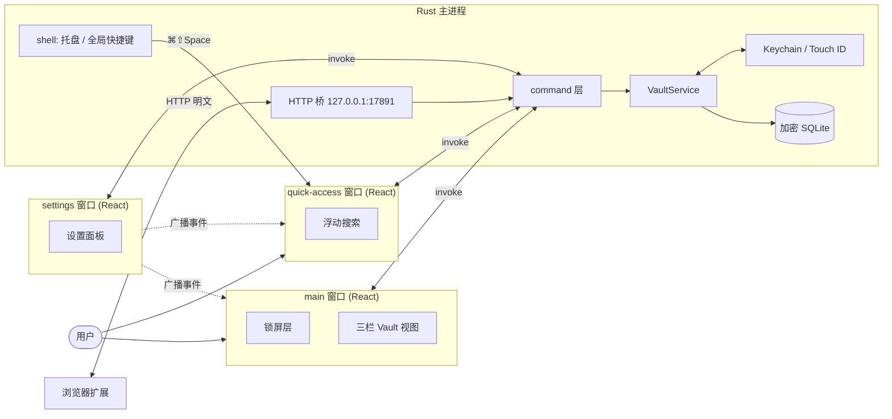
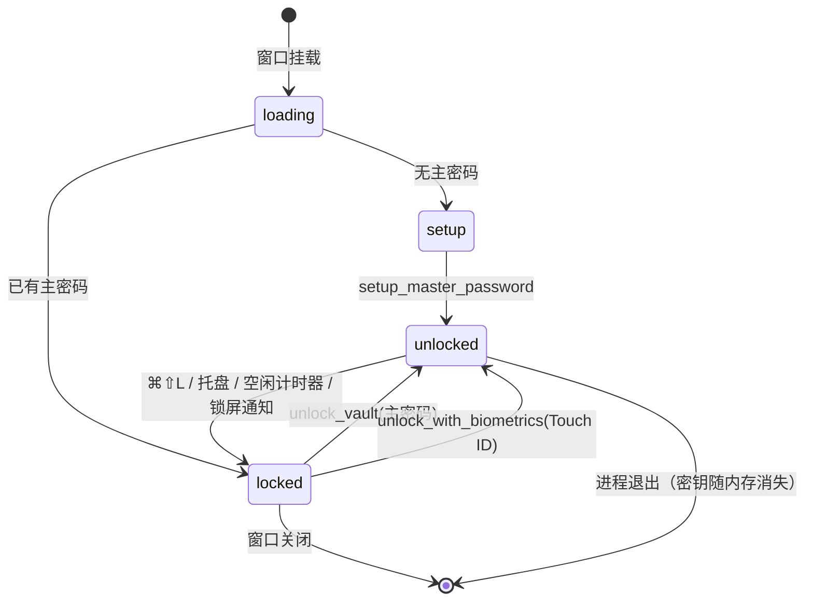
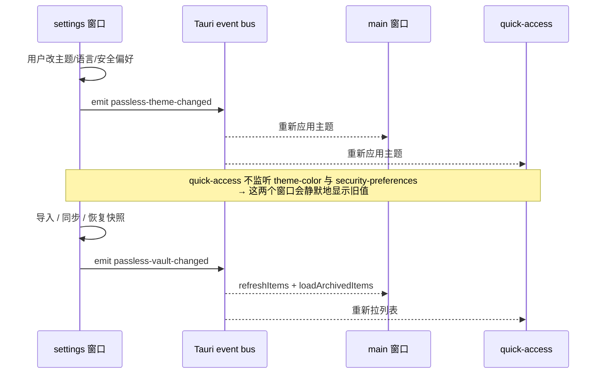
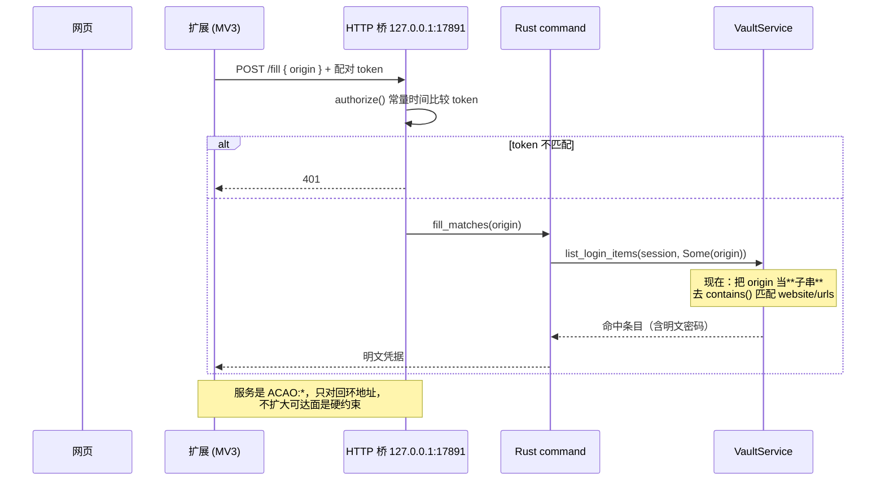
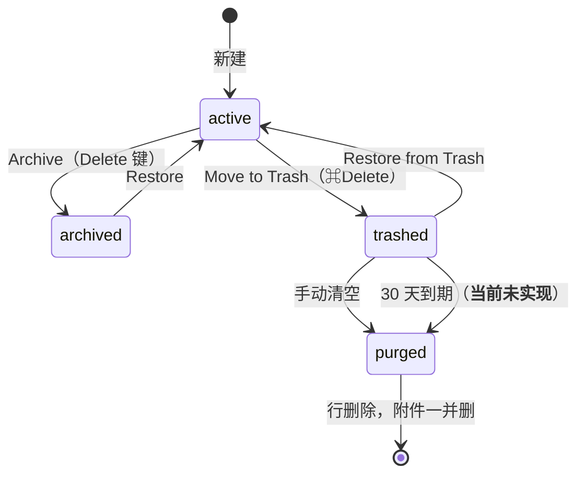

# 流程说明 — Cupertino Vault 界面重构

> 本文只解释"系统怎么跑起来"，不做详细设计。详细设计见 [design.md](design.md)，执行计划见 [implement.md](implement.md)。

## 1. 背景与本文覆盖范围

Passless 目前是 Tauri v2 桌面密码管理器：一个 3022 行的 `src/App.tsx` 里塞了三个窗口
（`main` / `settings` / `quick-access`），Rust 侧提供 47 个 `#[tauri::command]`。目标界面由
Stitch 原型 `stitch_1password_web_clone`（4 屏）+ `docs/design/2026-10-07-cupertino-vault-design-spec.md`
定义，交互逻辑对齐 1Password 8 macOS 客户端。

本文覆盖四条跨进程/跨窗口的流程，它们的共同点是**没有一个单一控制者**，状态靠 Tauri 事件
广播同步，所以必须单独画出来：

1. 解锁状态机（含生物识别与异常退出）；
2. 三窗口之间的一致性（谁改了什么、另一个窗口怎么知道）；
3. 条目编辑 → 草稿 → 提交 → 同步；
4. 浏览器扩展经本地 HTTP 桥发起的自动填充与保存。

不覆盖：单个组件内部的视觉细节（在 design.md 的组件规格里）、Rust 加密原语。

## 2. 核心流程总览



关键点：**三个 React 窗口没有共享 store**，跨窗口状态完全靠 5 个 `passless-*-changed`
事件（`App.tsx:485/493/503/515/566`）。Rust 侧不持有任何 UI 状态。

## 3. 解锁状态机



约束（不可协商，来自 AGENTS.md）：

- **vault key 只存在于 `AppState` 的 session mutex 中**，解锁期间存活，锁定即释放。
  不写 Keychain、不落解密缓存、不进备份文件。
- 空闲自动锁定目前**只在渲染进程**用 `setTimeout` 实现（`App.tsx:606-614`），
  监听 `mousemove/mousedown/keydown/scroll/touchstart` 重置。系统休眠、屏保、
  应用被切到后台都不在它的感知范围内 —— 这是 design.md 决策 **D-11** 的输入。

## 4. 三窗口一致性



**当前缺口**：main 窗口自己修改数据时（保存条目、切换 vault）**不广播**
`passless-vault-changed`，所以 quick-access 面板会显示过期的条目列表。
design.md §6.3 用统一的 mutation 出口修掉它。

## 5. 条目编辑流程

原型同时出现"Draft auto-saved 14s ago"和"取消 / 保存"两个按钮，两者语义冲突。
下图按 design.md 决策 **D-02（显式提交 + 崩溃草稿）** 画：

```mermaid
flowchart TD
    A[选中条目 · 只读] -->|⌘E / 点击编辑| B[编辑会话开始<br/>载入 working copy]
    B --> C{字段变更}
    C -->|防抖 800ms| D[写本地草稿<br/>draft store]
    D --> E[显示"草稿已自动保存 Ns 前"]
    C -->|⌘S / 点击保存| F{title 非空?}
    F -->|否| G[阻止提交并提示]
    F -->|是| H[update_login_item<br/>整文档替换]
    H --> I{成功}
    I -->|是| J[清草稿 · 退出编辑 · 触发同步]
    I -->|否| K[保留编辑态 + 错误横幅<br/>草稿仍在]
    C -->|Esc / 取消| L{有未保存改动?}
    L -->|否| A
    L -->|是| M[确认丢弃] --> A
    B -.->|进程异常退出| N[下次进入该条目<br/>提示恢复草稿]
```

必须显式处理的分支：

| 分支 | 触发 | 结果 |
|---|---|---|
| 提交失败 | Rust 返回错误 | 停留编辑态，草稿保留，错误横幅常驻（当前无此横幅） |
| 锁屏打断 | 空闲计时器在编辑中到期 | **先弹确认，不得静默丢弃未保存改动** |
| 切换 vault | 编辑中点侧栏另一个 vault | 同上 |
| 附件 | 新建未保存条目时选文件 | 当前实现会静默丢弃（`App.tsx:943` 仅在条目已存在时挂载） |
| 并发 | 扩展 `/save` 改写了正在编辑的条目 | 需要 `updated_at` 比对，冲突时提示而非覆盖 |

## 6. 浏览器桥自动填充流程



**子串匹配是安全缺陷，不是 UI 细节**：`matches_query`（`vault.rs:1188-1208`）判断的是
`stored_url.contains(origin)`。存了 `https://github.com.evil.io` 的条目会在用户访问真实
`https://github.com` 时被命中。原型里的 "Exact match / Base domain match / Never submit"
正好是解法，见 design.md §6.5。

## 7. 归档 / 回收站生命周期



1Password 语义：Archive 无限期保留、仅从搜索与自动填充中隐藏；Trash 保留 30 天。
Passless 的 `archived` / `trashed` / `deleted_at` 三列和 4 个 Rust 命令都已就位
（`storage.rs:122-124`、`lib.rs:670-676`），**缺的是到期清理和全部 UI**。

## 8. 失败与降级路径汇总

| 失败 | 现状 | 目标 |
|---|---|---|
| 解锁失败 | 锁屏内错误横幅 | 保留；补 Touch ID 不可用时的降级说明 |
| `list_login_items` 解密单条失败 | `get_login_item` 返回 `None`，条目**静默消失** | 计数上报，列表显示"N 项无法解密" |
| 保存失败 | 只有 `success-banner`，解锁视图内无错误横幅 | 编辑态错误横幅 + 不退出编辑 |
| 桥 token 过期 | 401 | 保留；不新增暴露面 |
| 同步失败 | `maybeAutoSync` 静默 | 状态条显示失败并给重试 |
| 无密码重置 | **不存在任何恢复路径**（2026-10-08 已真实丢过一次库） | 见 design.md 决策 D-09 |
